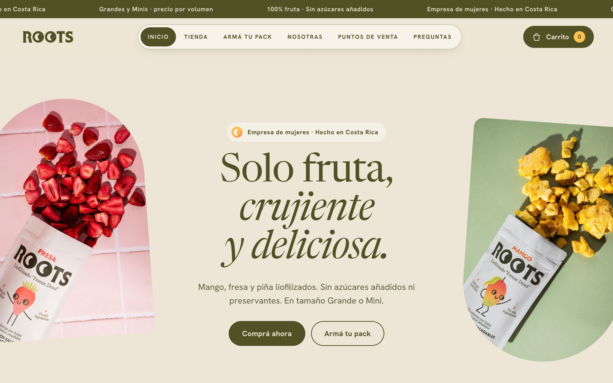
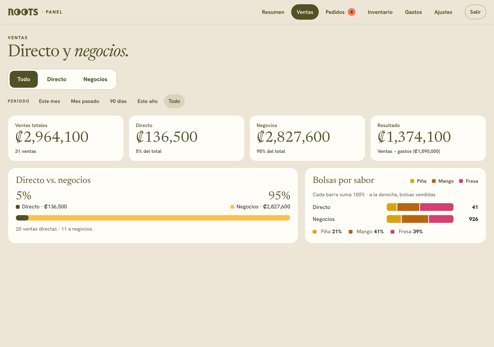
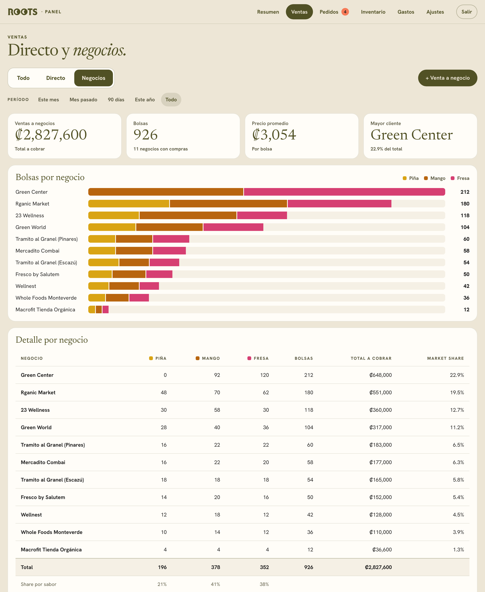
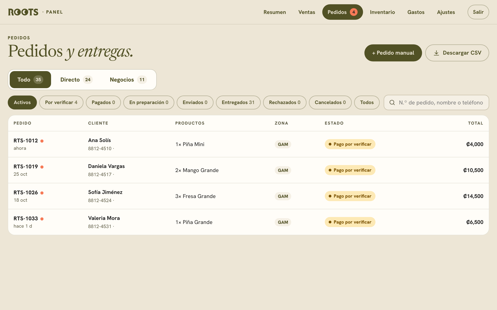
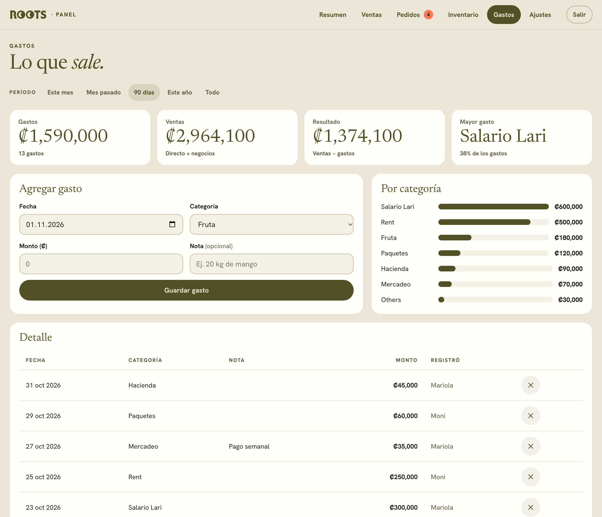
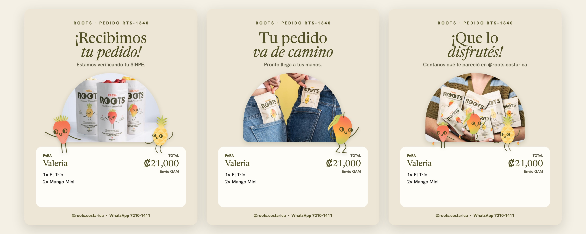
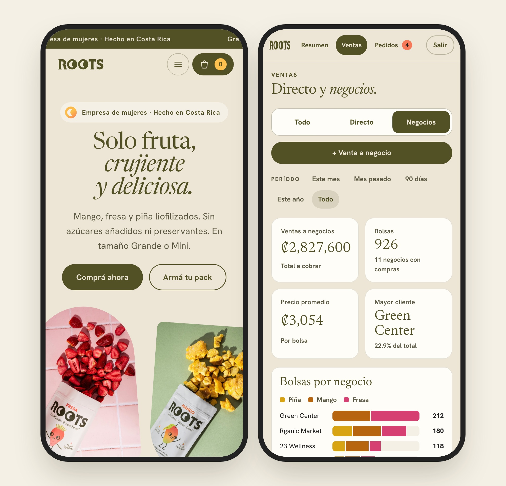

# Roots: storefront + owners' back office

**A live online store and the order panel behind it, for a women-owned freeze-dried fruit brand in Costa Rica.**

[Live store](https://roots-tienda.netlify.app) · Owners' panel (login only) · [Setup guide](docs/SETUP.md)

> The interface is in Spanish (Costa Rican *voseo*), because that's who uses it.
> Screenshots of the panel use sample data, not the business's real figures.

---

## The problem

Roots sells freeze-dried mango, strawberry and pineapple in two sizes, to people directly (Instagram, WhatsApp, an online store) and wholesale to 13 shops. Before this project:

- **Orders lived in a spreadsheet** typed by hand: one tab for direct sales, one for shops, a summary tab with formulas.
- **The store was a design prototype.** Checkout looked real, but no order ever reached the business.
- **Payments are by SINPE Móvil** (Costa Rica's instant bank transfer), so every order needs a person to check the bank app and match a screenshot to an amount.
- **The owners needed to see direct and wholesale sales separately**, by flavor and by shop, and track expenses next to them.

## What I built

### 1. A store that actually takes orders
Customers fill in their delivery details (province → canton, which decides the shipping zone), get an order number **before paying**, so they can write it in the SINPE transfer note, and upload the receipt. The order lands in the owners' panel within seconds.

### 2. A back office for the owners

| | |
|---|---|
|  |  |
| **Ventas · Todo**: direct vs. wholesale share, and the flavor mix of each channel. | **Ventas · Negocios**: the owners' spreadsheet view, redesigned: bags per shop by flavor, amount owed, market share. |
|  |  |
| **Pedidos**: every order with its status, segmented into direct clients and businesses. | **Gastos**: expenses by category; the owners edit the categories themselves. |

- **Login per owner** (email + password). Only emails on the owners' list get in.
- **Order flow**: payment to verify → paid → preparing → shipped → delivered. Confirming a payment takes the bags out of inventory; cancelling puts them back.
- **An activity log**: every change records who made it ("RTS-1050: paid → shipped · Ana").
- **Manual orders and wholesale deliveries** for sales that don't come through the store.

### 3. Images the owners send customers on WhatsApp
Each status change generates a shareable image with real product photography and the brand's mascots, the *Froots*. On a phone, one tap opens WhatsApp with the image and a ready-made message.

### 4. Their history, moved in and checked
A script turns the owners' spreadsheet into one database load: about 330 past sales, direct and wholesale, March to November. It **checks itself against the spreadsheet's own summary tab**, month by month. That check found 18 sales the owners' summary had silently skipped (a trailing space in the month name broke the formula), about **6% of their direct revenue**.

---

## Decisions worth explaining

**Prices are calculated in the database, not the browser.** Volume pricing (5+ bags, 10+ bags), the shipping zone and the total are recalculated by a Postgres function when the order is placed. A customer editing the page can't change what they owe.

**The public can do exactly three things.** Row-level security means the store's public key can read the SINPE details, reserve an order number and place an order, and nothing else. It can't read a single order back.

**Inventory moves with the payment, not the order.** Stock comes out when a payment is confirmed, in the same database transaction as the status change, so the two can't disagree. Unpaid or rejected orders never touch stock.

**Colors carry meaning, so they were tested.** Each flavor has a fixed color (pineapple gold, mango amber, strawberry raspberry), checked for color-blind separation and contrast, and always paired with the flavor's name in legends and tables.

**Filters say what they filter.** The sale-type switch (All / Direct / Business) is a prominent segmented control; time ranges are quieter pills underneath. An empty period says so and offers "see all", instead of showing zeros.

**The owners' tools stay theirs.** Shop names, expense categories and wholesale prices are lists they edit in the panel, not values in code. An optional sync also copies each order into their Google Sheet, because that's where they were used to working.

## Stack

| | |
|---|---|
| Store | The original design (a Claude Design canvas) served as a static site through a small renderer I wrote for its template format ([`store/dc-lite.js`](store/dc-lite.js)), on React |
| Panel | Plain HTML/CSS/JS, no build step |
| Data | Supabase: Postgres, Auth, row-level security, Realtime ([`supabase/`](supabase/)) |
| Hosting | Netlify, deployed from GitHub on every push; keys come from environment variables |
| Design system | Tokens, brand book and components extracted from this code into a Claude Design system ([`design-system/`](design-system/project/README.md)), so new designs start from the shipped product |
| Extras | Google Apps Script sheet sync ([`sheets/Code.gs`](sheets/Code.gs)); spreadsheet importer ([`tools/import_excel.py`](tools/import_excel.py)) |

Designed and built with Claude (Claude Design for the storefront, Claude Code for the build).

## Run it yourself
See the [setup guide](docs/SETUP.md): one Supabase project, four SQL files, two Netlify sites.
