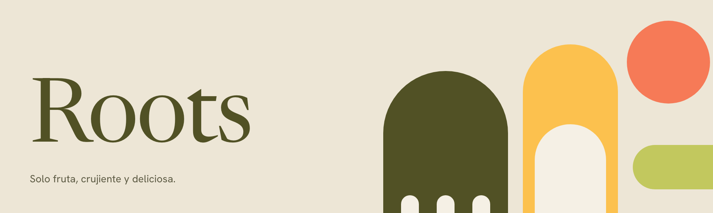
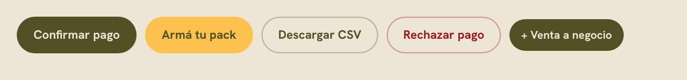
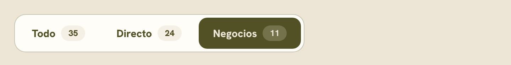
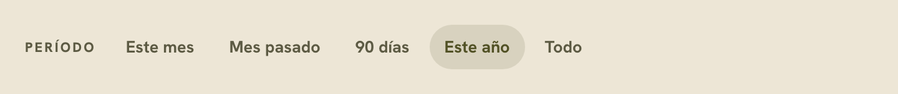
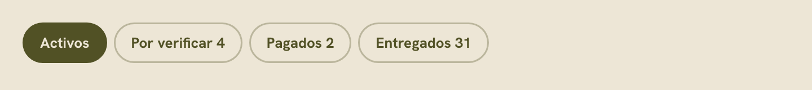
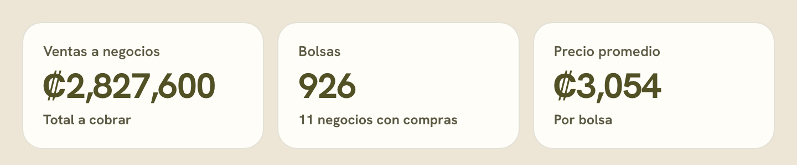
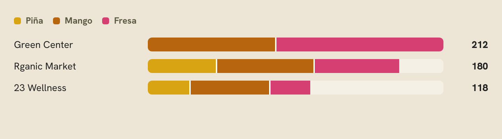
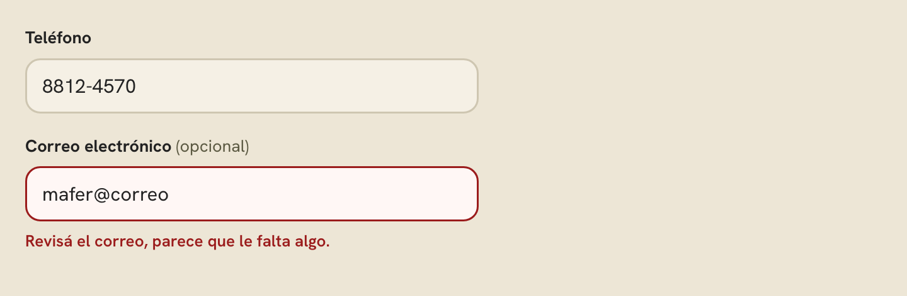
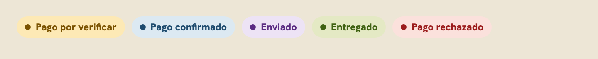
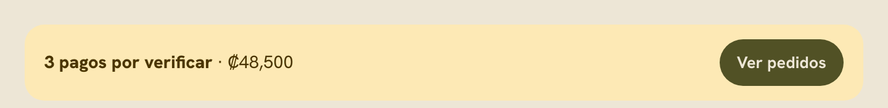

# Roots

Freeze-dried fruit from Costa Rica, made by a women-owned company: mango, fresa and piña, in Grande and Mini bags. This system covers the online store and the owners' back office, and is built from their code in [monigonzalezux/roots](https://github.com/monigonzalezux/roots).

## Voice and content

- **Spanish, Costa Rican *voseo*.** "Comprá ahora", "Armá tu pack", "Revisá el SINPE". Never *tú* forms.
- **Plain and warm.** Short sentences, the way the owners talk on WhatsApp. "¡Recibimos tu pedido!", not "Su orden ha sido procesada".
- **Fruit first.** Name the flavor before anything else: "Mango Grande", "Pack de 5 Grandes (2 Mango · 3 Fresa)".
- **Money in colones**, no decimals, comma thousands: ₡12,000. Tabular figures wherever numbers line up.
- **Buttons say what happens:** "Confirmar pago", "Marcar enviado", "+ Venta a negocio".

## Color

The brand is olive and bone, with honey, coral and lime as accents. It has one theme: light.

- **`musgo` on `hueso`** is the default pairing for headings, text and primary buttons. Cards sit on `card`, a step lighter than the page.
- **`miel`** is the second action color. Put `musgo` text on it, never white, and never use it as text on `hueso`.
- **`coral` and `lima`** are decorative signals (badges, the receipt drop zone, highlight rings). They are not text colors.
- **Flavor colors are fixed:** `flavor-pina` gold, `flavor-mango` amber, `flavor-fresa` raspberry. They were checked for color-blind separation. Every chart that uses them also writes the flavor's name, in a legend or a table. Minis use the same color at 55% opacity, labelled "Mini".
- **Status pairs** (`ok`, `warn`, `info`, `bad`, `pur`, each with a `-bg`) belong to order states only: verificar → `warn`, pagado → `info`, enviado → `pur`, entregado → `ok`, rechazado → `bad`. Always shown as a pill with the state's name.

## Type

- **Newsreader** (`serif`) only for page titles in the panel and big display lines in the store. The second half of a title goes in italic: "Directo y *negocios.*"
- **Hanken Grotesk** (`sans`) for everything else, card titles and big numbers included, so the panel reads clean. Labels and buttons in 700, eyebrows (`caps`) in 800, uppercase, 0.14em tracking.
- The brand book specifies Affairs, Lumiere and ALS Hauss. None of them is licensed for the web yet, so Newsreader and Hanken Grotesk stand in until they are.

## Shape and space

- **Pills** (`radius-pill`) for every button, chip, status and badge. **Soft rectangles** (`radius-xl`, 20px) for cards, `radius-md` for inputs.
- **Arches** frame photography: a full half-circle on top, square-ish corners at the bottom. You see them in the store hero and the customer status images.
- Gutters are `space-4` on phones and `space-5` on desktop. Cards stack to one column at phone width.

## Imagery

- **Photography** shows the real bags, white with the musgo wordmark, on solid color fields (sky blue, honey yellow, blush) or held in hands. Use the shots in *Photography*, cropped toward the bags.
- **The Froots** (Mango, Fresa, Piña) are the mascots on every bag. Use them whole, never cropped or recolored, standing in front of photos or cards. Give them a soft shadow (`shadow-toast` strength or lighter).
- **Icons** are drawn inline: 24px grid, 1.8 stroke, round caps and joins, `currentColor`. No emoji.

## Components

The pieces below are the panel's own classes (`components/bundle.css`), shown as static renditions. Each one's folder in `components/` has its README and an HTML preview.

| Group | Component | Use it for |
|---|---|---|
| Actions | [Button](#button) | Every action, as a pill |
| Navigation | [SegmentedControl](#segmentedcontrol) | Choosing the type of sale |
| | [PeriodFilter](#periodfilter) | Time ranges |
| | [Chip](#chip) | Filters inside a list |
| Data | [KpiTile](#kpitile) | A headline number |
| | [FlavorStackBar](#flavorstackbar) | Bags per flavor in one row |
| Forms | [Field](#field) | A labelled input with its error |
| Feedback | [StatusPill](#statuspill) | An order's state |
| | [AlertBar](#alertbar) | Something that needs attention now |

### Actions

#### Button
Every action in the panel and the store, as a pill.

- **`btn-m`** (musgo) for the main action of a view, such as "Confirmar pago". One per view.
- **`btn-miel`** for a second strong action, such as "Armá tu pack".
- **`btn-o`** (outline) for secondary actions.
- **`btn-bad`** for rejecting or cancelling.
- Add **`btn-sm`** in toolbars.

Labels start with a verb. A leading 18px stroke icon (`.ico`) is optional.

### Navigation

#### SegmentedControl
Switches the whole view between types of sale: Todo, Directo, Negocios.

It's the loudest filter on a page and always sits **above** the time filters. The count in each segment is optional. At phone width it stretches to full width with equal segments.

#### PeriodFilter
Quiet pills for the time range, labelled *Período*.

It's lighter than the SegmentedControl on purpose, so the two never compete. The selected range gets a soft musgo fill. When the chosen period is empty, pair it with an AlertBar that offers "Ver todo".

#### Chip
Filters inside a list, such as order status, with an optional count.

Use chips for many options of equal weight. For the type of sale use SegmentedControl; for time, PeriodFilter.

### Data

#### KpiTile
A headline number with its label and a one-line note.

Numbers are Hanken Grotesk bold with tabular figures, colones without decimals. The note says what the number includes or how it compares. Tiles sit four in a row on desktop and two on phones.

#### FlavorStackBar
Bags per flavor in one row, stacked in the flavor colors.

The order is always Piña, Mango, Fresa. A 2px gap separates the segments, the legend is always shown, and each row's total sits at the right.

### Forms

#### Field
A labelled input with an optional hint and its error line.

Labels sit above the input in 13.5px bold, and optional fields say "(opcional)". An error turns the border `bad` and says how to fix it, in voseo: "Revisá el correo".

### Feedback

#### StatusPill
An order's state, with its color and its name.

These colors belong to order states only: verificar `warn`, pagado `info`, enviado `pur`, entregado `ok`, rechazado `bad`. Never color alone: the pill always carries the state's name.

#### AlertBar
Something that needs attention now, with one action.

Use it for pending payments, missing setup or an empty period. Write one sentence with the key fact in bold, and give it one button.

## In the code

The live store and panel read these tokens. In the repository, `tools/build-tokens.mjs` turns `design-system/project/tokens.json` into `roots-tokens.css` (every color, the two font stacks, spacing, radii and shadows as CSS custom properties), and both sites load it. Netlify rebuilds it on every deploy, so a token changed in the repository reaches both sites. To bring a change made here into the code, copy this system's `tokens.json` into the repository and push.

## Not synced

- **Gradients** from the store (`--g-mango`, `--g-fresa`, `--g-pina`, `--g-hojas`) are not tokens here, because the token format holds solid colors only. They live in the store's code.
- **The store's 18% and 34% line opacities** were folded into `line` and `line-2` (16% and 32%); the store now uses these.
- **The brand-book typefaces** have no font files: Newsreader and Hanken Grotesk load from Google Fonts.
- **Components** are static renditions of the panel's CSS. The store's template components are not included.
- **The images in this README** (`../img/`) live next to this folder in the repository, so they don't show inside Claude Design. Each component's live preview is its `preview.html`.
